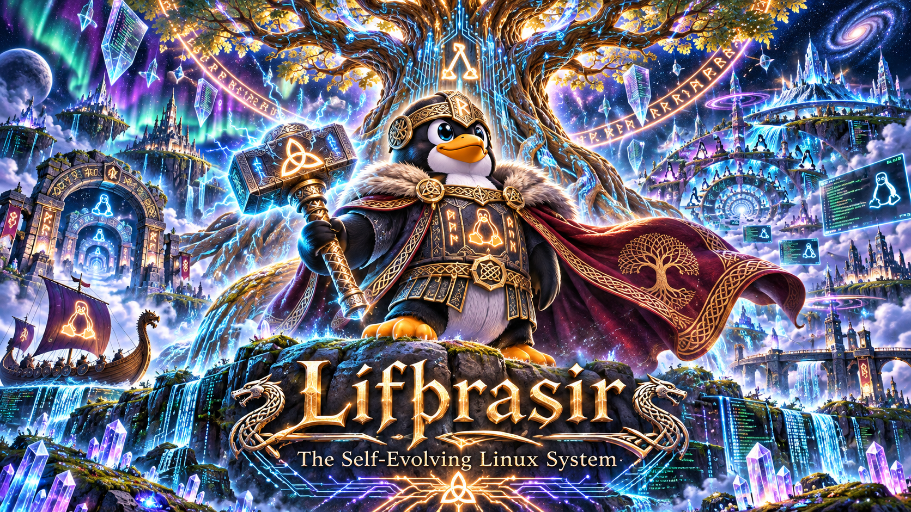

# RuneForgeAI Lifthrasir

ᛚᛁᚠᚦᚱᚨᛊᛁᚱ ⚡🌳

### Project Lífþrasir

The Self-Evolving Linux System

Official repository name: `RuneForgeAI-Lifthrasir`

Motto: Linux that heals, learns, evolves, and gives back.

Lífþrasir will bring together the Mythic Engineering ecosystem:

* Thor: Autonomous threat hunting and defense.

* Eir: System healing and recovery.

* Mímir: Research, diagnostics and accumulated knowledge.

* Replicater: Coordinated agentic engineering and experimentation.

* The Upstream Forge: Verified patches contributed back to Linux maintainers.

The long-term vision is a Linux ecosystem where computers collaborate to discover problems, engineer solutions, test improvements and contribute their discoveries to the open-source world.

And the Norse symbolism is fitting: Lífþrasir survives Ragnarök and participates in the renewal of the world.

A fitting name for an operating system designed not merely to survive, but to continually renew itself. ᛟ

