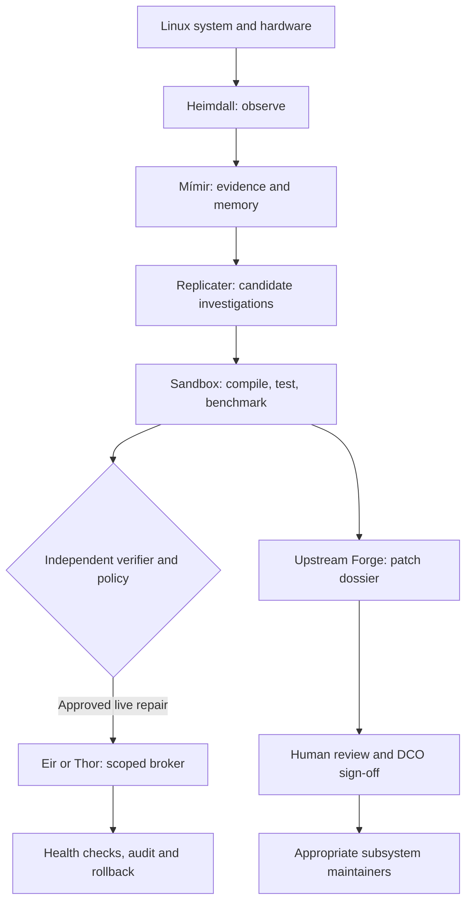

# ᛚᛁᚠᚦᚱᚨᛊᛁᚱ Project Lífþrasir
### The Self-Evolving Linux System

> **Linux that heals, learns, evolves, and gives back.**

**[Explore the complete 40-document research library](research/README.md)** · [Master research atlas](research/00-RESEARCH-ATLAS.md) · [Roadmap](research/27-ROADMAP-AND-MILESTONES.md) · [Research references](research/31-RESEARCH-BIBLIOGRAPHY.md)

## The vision

Lífþrasir is a **Mythic Engineering / RuneForgeAI research project** exploring Linux that can diagnose failures, safely repair eligible problems, independently test improvements and prepare evidence-backed patches for the wider Linux community. It envisions an **opt-in distributed engineering network** where participating systems contribute reusable technical knowledge without surrendering user control or private data.

**Current status:** research documents, GPLv2 license, project art and initial project organization. The planned autonomous Linux features are **not yet implemented**; proposals are labeled accordingly. Production kernel edits, boot changes and destructive system actions are outside the initial scope.

## The engineering pantheon

| Role | Technical purpose |
|---|---|
| **Heimdall** | Observe system services, logs, kernel and device health |
| **Mímir** | Local technical memory, research and evidence-grounded hypotheses |
| **Replicater** | Bounded multi-agent investigation and independent testing |
| **Eir** | Human-authorized reversible repair and rollback |
| **Thor** | Defensive threat hunting and reversible containment |
| **Upstream Forge** | Human-reviewed, reproducible patch dossiers for kernel maintainers |

*The engineering pantheon is a human-readable way of organizing responsibilities. Each role is a proposed component, not a claim of implemented autonomous capability.*

## Proposed architecture

The **design principle** is separation of powers: observation produces evidence, agents produce proposals, a deterministic policy engine checks permissions, and an independently controlled broker carries out strictly scoped actions. The diagram above illustrates this intended architecture; its implementation remains future work.

**Security boundary:** An LLM never holds unrestricted root privileges. All host changes use a deterministic policy engine and a narrow privileged broker. Experimental fixes are tested in disposable VMs; live modifications require explicit permission and a proven recovery plan.

**Evidence is not authority.** Logs, documentation, network responses and model outputs are treated as untrusted inputs. A safe plan must specify the exact target, intended effect, preconditions, authorization and recovery method. In particular, an agent's confidence cannot grant itself administrative access.

## Research highlights

- **Architecture:** [reference design](research/02-REFERENCE-ARCHITECTURE.md), [threat model](research/03-THREAT-MODEL-AND-TRUST.md), [safe rollback](research/04-SAFE-REPAIR-AND-ROLLBACK.md).
- **Agent systems:** [Replicater](research/05-REPLICATER-ORCHESTRATION.md), [Eir](research/07-EIR-HEALING-ENGINE.md), [Thor](research/08-THOR-DEFENSE.md), [Mímir](research/09-MIMIR-KNOWLEDGE-AND-RAG.md).
- **Linux internals:** [kernel and drivers](research/12-KERNEL-DRIVER-RESEARCH.md), [fuzzing](research/15-FUZZING-AND-FAULT-INJECTION.md), [resource management](research/17-RESOURCE-MANAGEMENT.md), [GPU and NPU](research/18-ACCELERATOR-SUPPORT.md).
- **Self-evolution:** [controlled patch lifecycle](research/32-AUTONOMOUS-PATCH-LIFECYCLE.md), [formal verification](research/33-FORMAL-POLICY-VERIFICATION.md), [distributed federation](research/20-DISTRIBUTED-FEDERATION.md).
- **Implementation:** [APIs](research/25-API-AND-EVENT-SCHEMAS.md), [test plans](research/28-PROTOTYPE-EXPERIMENTS.md), [development roadmap](research/27-ROADMAP-AND-MILESTONES.md).

## The path from research to self-evolving Linux

The envisioned path starts with a **reproducible offline laboratory and read-only monitoring**, grows into an authorized Eir repair engine, and only then advances toward bounded agent collaboration, Thor's defensive investigations, kernel experimentation and voluntary multi-machine research. Each phase must pass defined tests before the next risk level is enabled.

- **[Master roadmap to completion](ROADMAP-TO-COMPLETION.md):** engineering phases P0–P16, dependencies, evidence gates and release targets.
- **[Implementation books and backlog](roadmap/INDEX.md):** concrete work packages, quality checks and milestone definitions.
- **[Cross-platform validation matrix](roadmap/08-TEST-MATRIX-AND-RELEASE-GATES.md):** scenarios that determine whether a feature actually works.

_The roadmap image illustrates proposed milestones, not features that have already shipped._

## First practical milestone

In a **disposable Kubuntu VM**, detect a deliberately broken noncritical user service, explain its likely cause with evidence, propose an exact reversible fix, obtain consent, apply via the scoped policy broker, verify functionality and prove rollback. This must work **offline** and remain operable if the AI model stops running.

**Six-step recovery contract:** Observe a failure → diagnose with reproducible evidence → show the proposed action for authorization → apply only the approved change → verify the user-visible outcome → either close the incident or invoke the tested rollback path. The supervisor and recovery controls must continue to operate if local AI inference is unavailable.

## Platform expansion: start narrow, grow safely

The **initial engineering target is Kubuntu on x86-64**, using disposable test environments. Research plans then expand to Debian, Fedora, openSUSE, Arch, and ARM64 hardware as adapters and repeatable tests become available. **No distribution or architecture is currently announced as a supported production release.** Snapshot support, package management, device drivers and boot recovery differ between installations; the system must discover capabilities rather than assuming them.

## The kernel laboratory and patch science

The **Upstream Forge** is intended to transform an investigated problem into a **reviewable patch dossier**, not a flood of untested code. For relevant kernel changes, that means a pinned source revision, a failure reproducer, a minimal change, independent build and regression tests, and explicit documentation of what was *not* tested. Research tools include [KUnit](https://docs.kernel.org/dev-tools/kunit/usage.html), [kselftest](https://docs.kernel.org/dev-tools/kselftest.html), [Linux Test Project](https://linux-test-project.readthedocs.io/), and [syzkaller](https://github.com/google/syzkaller), with dangerous experiments restricted to disposable labs.

## Federation: many machines, independent owners

A future **opt-in research federation** could let Linux machines exchange *sanitized bug reproductions, benchmark evidence and proposed fixes* without sharing raw private logs or granting other machines root access. Every node should independently verify findings in its own lab and retain the ability to run entirely offline. Joining a collective research effort must never become permission for another participant to modify a user's computer.

## Contributing Linux patches responsibly

Linux kernel patches normally go to the appropriate subsystem maintainers and mailing lists, not automatically to Linus Torvalds or GitHub pull requests. A **human** reviews AI-assisted work, accepts responsibility and supplies any legitimate Developer Certificate of Origin sign-off. AI agents must not invent Signed-off-by tags or flood maintainers with unreviewed patches.

[Linux kernel contribution guide](https://docs.kernel.org/process/submitting-patches.html) · [AI coding assistant guidance](https://www.kernel.org/dochtml/latest/process/coding-assistants.html) · [Project upstream research](research/21-UPSTREAM-CONTRIBUTIONS.md)

## License

This repository contains the GNU **GPL version 2** license text, with GPL-2.0-only intended for compatible project code. Dependencies, firmware, model weights and artwork require their own license checks; see [licensing research](research/30-LICENSING-AND-DEPENDENCIES.md).

---

*Observe before judging. Test before changing. Preserve before repairing. Verify before contributing.* ᛟ
