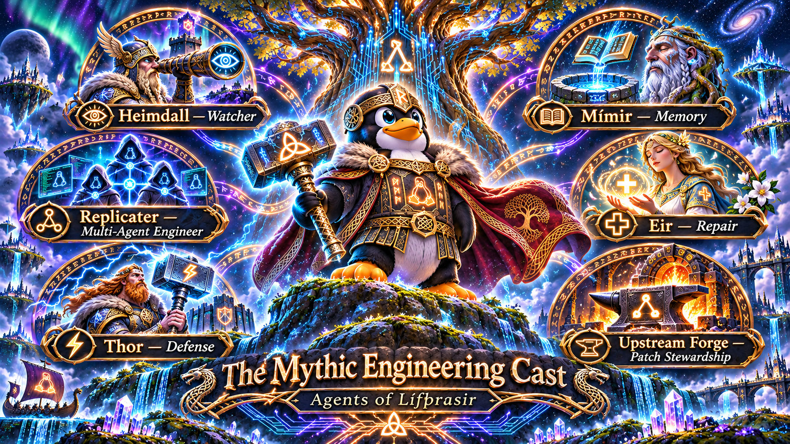
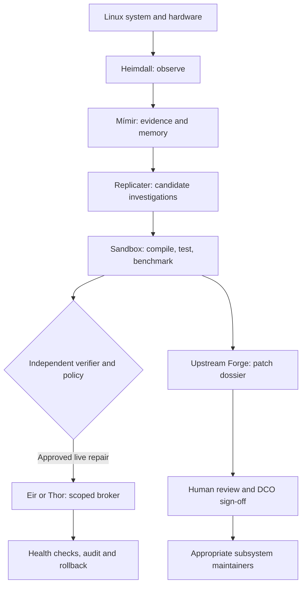
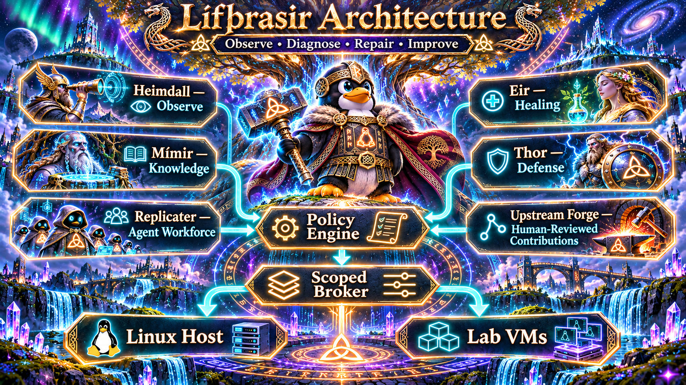
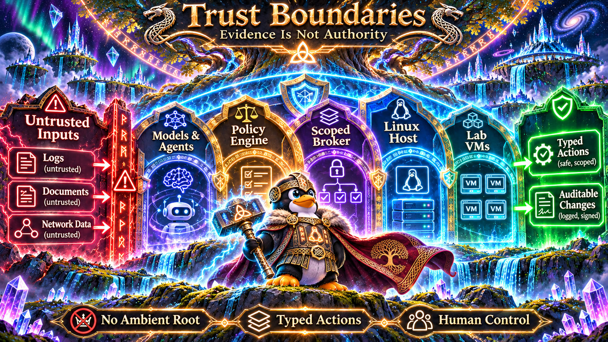
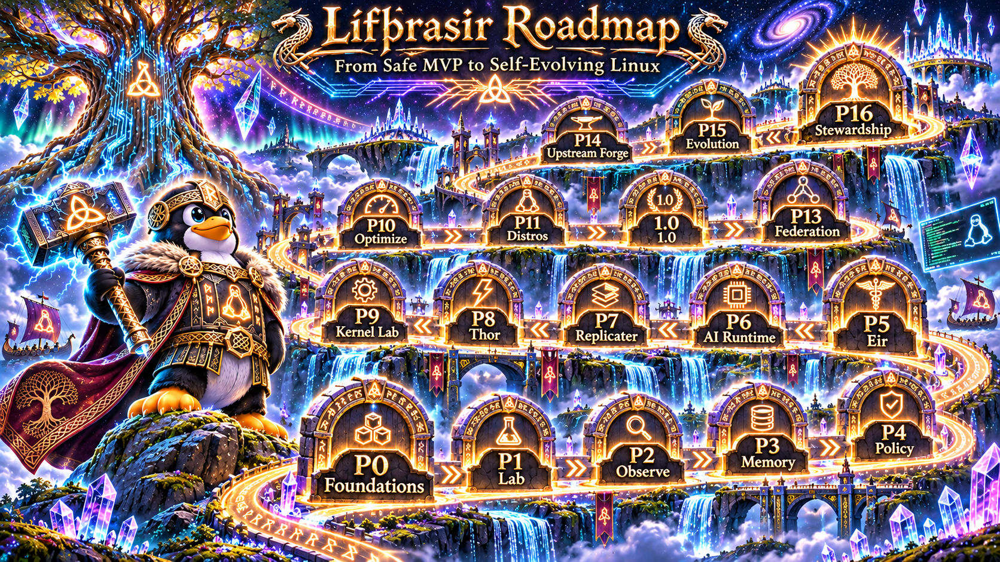
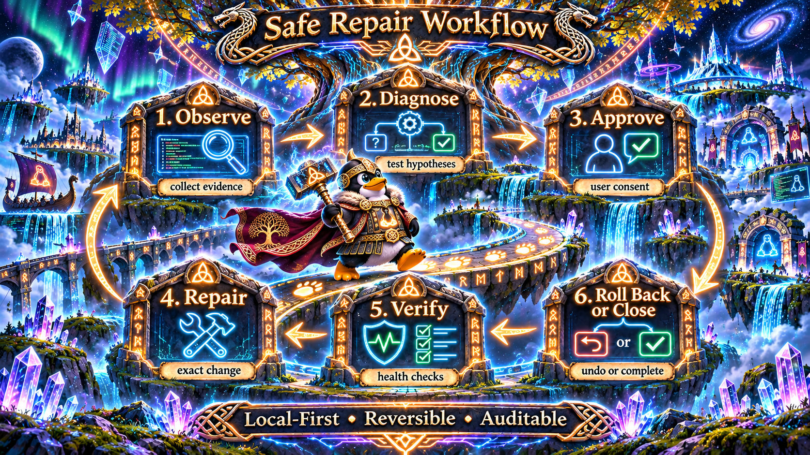
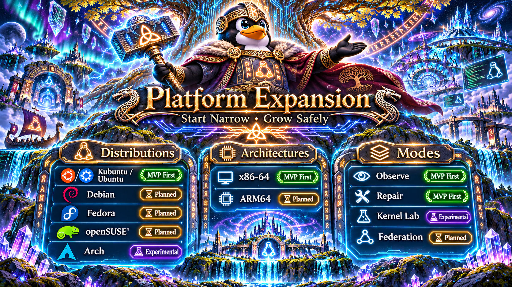
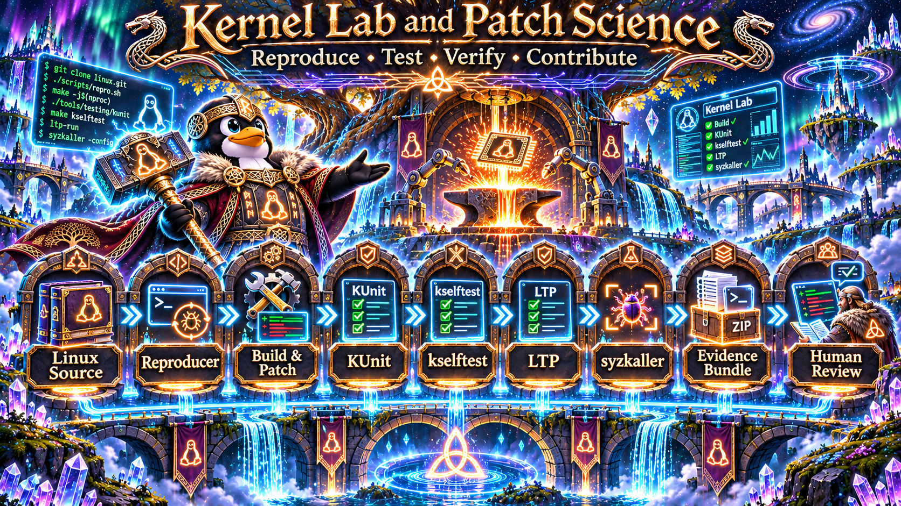
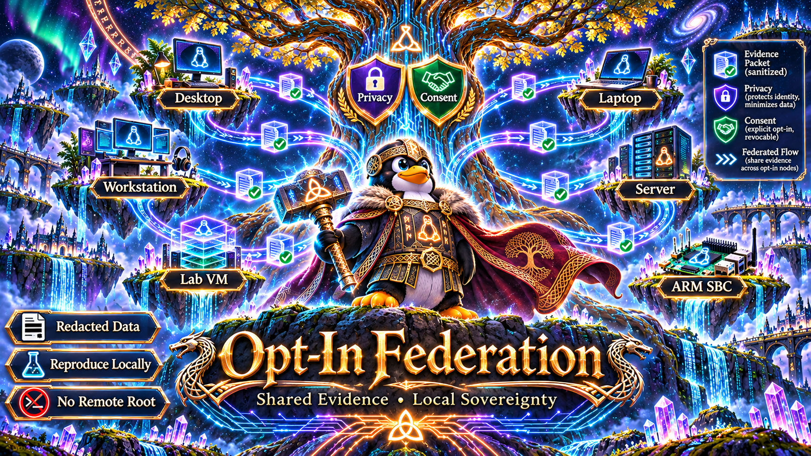

# ᛚᛁᚠᚦᚱᚨᛊᛁᚱ Project Lífþrasir
### The Self-Evolving Linux System

> **Linux that heals, learns, evolves, and gives back.**

**[Explore the complete 40-document research library](research/README.md)** · [Master research atlas](research/00-RESEARCH-ATLAS.md) · [Roadmap](research/27-ROADMAP-AND-MILESTONES.md) · [Research references](research/31-RESEARCH-BIBLIOGRAPHY.md)

## The vision

Lífþrasir is a **Mythic Engineering / RuneForgeAI research project** exploring Linux that can diagnose failures, safely repair eligible problems, independently test improvements and prepare evidence-backed patches for the wider Linux community. It envisions an **opt-in distributed engineering network** where participating systems contribute reusable technical knowledge without surrendering user control or private data.

**Current status:** research documents, GPLv2 license, project art and initial project organization. The planned autonomous Linux features are **not yet implemented**; proposals are labeled accordingly. Production kernel edits, boot changes and destructive system actions are outside the initial scope.

> **Development status update (2026-11-13):** The research-only description immediately above predates the 64-slice implementation campaign and the first real VM/host-observer activation. See [the dated progress and activation report](#development-progress-and-activation-status-2026-11-13) below for current evidence, live scope and remaining release gates.

## The engineering pantheon

| Role | Technical purpose |
|---|---|
| **Heimdall** | Observe system services, logs, kernel and device health |
| **Mímir** | Local technical memory, research and evidence-grounded hypotheses |
| **Replicater** | Bounded multi-agent investigation and independent testing |
| **Eir** | Human-authorized reversible repair and rollback |
| **Thor** | Defensive threat hunting and reversible containment |
| **Upstream Forge** | Human-reviewed, reproducible patch dossiers for kernel maintainers |

*The engineering pantheon is a human-readable way of organizing responsibilities. Each role is a proposed component, not a claim of implemented autonomous capability.*

## Proposed architecture

The **design principle** is separation of powers: observation produces evidence, agents produce proposals, a deterministic policy engine checks permissions, and an independently controlled broker carries out strictly scoped actions. The diagram above illustrates this intended architecture; its implementation remains future work.

**Security boundary:** An LLM never holds unrestricted root privileges. All host changes use a deterministic policy engine and a narrow privileged broker. Experimental fixes are tested in disposable VMs; live modifications require explicit permission and a proven recovery plan.

**Evidence is not authority.** Logs, documentation, network responses and model outputs are treated as untrusted inputs. A safe plan must specify the exact target, intended effect, preconditions, authorization and recovery method. In particular, an agent's confidence cannot grant itself administrative access.

## Research highlights

- **Architecture:** [reference design](research/02-REFERENCE-ARCHITECTURE.md), [threat model](research/03-THREAT-MODEL-AND-TRUST.md), [safe rollback](research/04-SAFE-REPAIR-AND-ROLLBACK.md).
- **Agent systems:** [Replicater](research/05-REPLICATER-ORCHESTRATION.md), [Eir](research/07-EIR-HEALING-ENGINE.md), [Thor](research/08-THOR-DEFENSE.md), [Mímir](research/09-MIMIR-KNOWLEDGE-AND-RAG.md).
- **Linux internals:** [kernel and drivers](research/12-KERNEL-DRIVER-RESEARCH.md), [fuzzing](research/15-FUZZING-AND-FAULT-INJECTION.md), [resource management](research/17-RESOURCE-MANAGEMENT.md), [GPU and NPU](research/18-ACCELERATOR-SUPPORT.md).
- **Self-evolution:** [controlled patch lifecycle](research/32-AUTONOMOUS-PATCH-LIFECYCLE.md), [formal verification](research/33-FORMAL-POLICY-VERIFICATION.md), [distributed federation](research/20-DISTRIBUTED-FEDERATION.md).
- **Implementation:** [APIs](research/25-API-AND-EVENT-SCHEMAS.md), [test plans](research/28-PROTOTYPE-EXPERIMENTS.md), [development roadmap](research/27-ROADMAP-AND-MILESTONES.md).

## The path from research to self-evolving Linux

The envisioned path starts with a **reproducible offline laboratory and read-only monitoring**, grows into an authorized Eir repair engine, and only then advances toward bounded agent collaboration, Thor's defensive investigations, kernel experimentation and voluntary multi-machine research. Each phase must pass defined tests before the next risk level is enabled.

- **[Master roadmap to completion](ROADMAP-TO-COMPLETION.md):** engineering phases P0–P16, dependencies, evidence gates and release targets.
- **[Implementation books and backlog](roadmap/INDEX.md):** concrete work packages, quality checks and milestone definitions.
- **[Cross-platform validation matrix](roadmap/08-TEST-MATRIX-AND-RELEASE-GATES.md):** scenarios that determine whether a feature actually works.

_The roadmap image illustrates proposed milestones, not features that have already shipped._

## First practical milestone

In a **disposable Kubuntu VM**, detect a deliberately broken noncritical user service, explain its likely cause with evidence, propose an exact reversible fix, obtain consent, apply via the scoped policy broker, verify functionality and prove rollback. This must work **offline** and remain operable if the AI model stops running.

**Six-step recovery contract:** Observe a failure → diagnose with reproducible evidence → show the proposed action for authorization → apply only the approved change → verify the user-visible outcome → either close the incident or invoke the tested rollback path. The supervisor and recovery controls must continue to operate if local AI inference is unavailable.

## Platform expansion: start narrow, grow safely

The **initial engineering target is Kubuntu on x86-64**, using disposable test environments. Research plans then expand to Debian, Fedora, openSUSE, Arch, and ARM64 hardware as adapters and repeatable tests become available. **No distribution or architecture is currently announced as a supported production release.** Snapshot support, package management, device drivers and boot recovery differ between installations; the system must discover capabilities rather than assuming them.

## The kernel laboratory and patch science

The **Upstream Forge** is intended to transform an investigated problem into a **reviewable patch dossier**, not a flood of untested code. For relevant kernel changes, that means a pinned source revision, a failure reproducer, a minimal change, independent build and regression tests, and explicit documentation of what was *not* tested. Research tools include [KUnit](https://docs.kernel.org/dev-tools/kunit/usage.html), [kselftest](https://docs.kernel.org/dev-tools/kselftest.html), [Linux Test Project](https://linux-test-project.readthedocs.io/), and [syzkaller](https://github.com/google/syzkaller), with dangerous experiments restricted to disposable labs.

## Federation: many machines, independent owners

A future **opt-in research federation** could let Linux machines exchange *sanitized bug reproductions, benchmark evidence and proposed fixes* without sharing raw private logs or granting other machines root access. Every node should independently verify findings in its own lab and retain the ability to run entirely offline. Joining a collective research effort must never become permission for another participant to modify a user's computer.

## Contributing Linux patches responsibly

Linux kernel patches normally go to the appropriate subsystem maintainers and mailing lists, not automatically to Linus Torvalds or GitHub pull requests. A **human** reviews AI-assisted work, accepts responsibility and supplies any legitimate Developer Certificate of Origin sign-off. AI agents must not invent Signed-off-by tags or flood maintainers with unreviewed patches.

[Linux kernel contribution guide](https://docs.kernel.org/process/submitting-patches.html) · [AI coding assistant guidance](https://www.kernel.org/dochtml/latest/process/coding-assistants.html) · [Project upstream research](research/21-UPSTREAM-CONTRIBUTIONS.md)

## License

This repository contains the GNU **GPL version 2** license text, with GPL-2.0-only intended for compatible project code. Dependencies, firmware, model weights and artwork require their own license checks; see [licensing research](research/30-LICENSING-AND-DEPENDENCIES.md).

---

## Development progress and activation status (2026-11-13)

> **Audit snapshot:** Friday, 13 November 2026, approximately 07:27 EST, based on the public main branch through commit [4a26be3](https://github.com/hrabanazviking/RuneForgeAI-Lifthrasir/commit/4a26be36127), the committed source and tests, [activation campaign records](ACTIVATION_STATE.md), [implementation ledger](PROJECT_MEMORY_MAP.md), and [laboratory evidence](lab/evidence/). This is a dated snapshot, not a claim that the live host was accessed during this README audit.
>
> **Current maturity:** The 64-item initial implementation/backlog campaign is banked at code/fixture level; **Activation Phase 1 has completed a real disposable-VM proof**; **Activation Phase 2 is running read-only observation on one developer workstation**. **Phase 3 host repairs and Phase 4 upstream delivery have not started.** There is no supported production release or independently validated self-modifying kernel.

### What changed since the original research-only README

The earlier research-stage paragraph above is a historical baseline, not the current code inventory. The repository now contains a substantial executable Python implementation and an activation campaign:

| Audited area | Evidence as of this snapshot | Correct maturity description |
| --- | --- | --- |
| Implementation backlog | **64 of 64** LIF work packages reported banked in [PROJECT_MEMORY_MAP.md](PROJECT_MEMORY_MAP.md), spanning roadmap phases P0–P16 | Work packages implemented/tested predominantly as contracts, fixtures and library components; **not** 64 production-deployed capabilities |
| Source | **44 Python modules** under [src/lifthrasir](src/lifthrasir), plus laboratory drivers and an observer, a read-only CLI, and a systemd user-service definition | Real deterministic Python behavior exists; most modules are still fixture-fed or record-oriented |
| Test inventory | **69 test_*.py modules** under [tests](tests); latest committed Phase 2 entry evidence reports **1,534 passed / 0 failed** | A project-recorded test run, **not independently rerun for this audit**; not a substitute for real-host, cross-platform or CI validation |
| Experimental records | **18 JSON evidence artifacts** under [lab/evidence](lab/evidence) | Recorded individual lab attempts, negative findings, successful recovery stages and activation proof, with narrower scope than full-system qualification |
| Live activation | [Phase tracker](ACTIVATION_STATE.md) and [observer unit](units/lifthrasir-observer.service) | Phase 1 complete; Phase 2 ongoing; no privileged host repair broker |
| GitHub delivery | Main-branch commit history is active; at audit time **no repository GitHub Actions workflow files, GitHub pull requests, GitHub issues or published releases** were found | Locally recorded test evidence exists, but no hosted CI/release pipeline is demonstrated |

**Why the distinction matters:** “banked” in the original [64-slice forge campaign](WAVE_PLAN.md) means its specified implementation and test artifacts were committed. The separate [activation plan](ACTIVATION_PLAN.md) adds real-machine proof gates. Neither campaign should be conflated with general availability, successful upstream submission, or an independently audited Linux distribution.

### Implemented technical foundations, with honest execution boundaries

- **Heimdall observation:** Typed observation-only event bus ([eventbus.py](src/lifthrasir/eventbus.py)), systemd failed-service and journal parsing ([systemd_collector.py](lab/systemd_collector.py)), /proc, cgroup and PSI sensors ([proc_sensors.py](lab/proc_sensors.py)), disk/network collectors, and a fixture-reading CLI ([heimdall_cli.py](ui/heimdall_cli.py)). The new [host_observer.py](lab/host_observer.py) wires selected read-only collectors to a **real, unprivileged host process**.
- **Mímir evidence and memory:** SQLite evidence storage, provenance and source hashing, exact text search, privacy redaction and retention/export-preview rules, causal hypothesis records, and poisoned-document handling ([eventstore.py](src/lifthrasir/eventstore.py), [provenance.py](src/lifthrasir/provenance.py), [search.py](src/lifthrasir/search.py), [privacy.py](src/lifthrasir/privacy.py), [hypotheses.py](src/lifthrasir/hypotheses.py), [contextguard.py](src/lifthrasir/contextguard.py)). These are usable building blocks, **not proof of a fully deployed autonomous knowledge service**.
- **Authority and Eir repair contracts:** A closed typed action catalog, deterministic deny-by-default policy decisions, bounded execution/confinement utilities, HMAC-bound single-use approval references, durable transactions and undo manifests, explicit reversible recipes, service-intent classification, verification/soak logic, and model-independent kill-switch machinery ([actions.py](src/lifthrasir/actions.py), [policy.py](src/lifthrasir/policy.py), [executor.py](src/lifthrasir/executor.py), [approval.py](src/lifthrasir/approval.py), [transactions.py](src/lifthrasir/transactions.py), [recipes.py](src/lifthrasir/recipes.py), [service_intent.py](src/lifthrasir/service_intent.py), [killswitch.py](src/lifthrasir/killswitch.py)). These components do **not** imply a deployed, approved privileged host broker.
- **Replicater and optional models:** Replaceable model-provider protocol, deterministic mock and local adapter, citation-grounded explanation templates, bounded DAG execution, separated reproducer/verifier roles, scheduling/arbitration and process quotas ([modelprovider.py](src/lifthrasir/modelprovider.py), [explanations.py](src/lifthrasir/explanations.py), [dagexecutor.py](src/lifthrasir/dagexecutor.py), [reproverify.py](src/lifthrasir/reproverify.py), [scheduler.py](src/lifthrasir/scheduler.py), [quotas.py](src/lifthrasir/quotas.py)). No fully autonomous, validated multi-agent production workforce is claimed.
- **Thor defensive intelligence:** Read-only process/package-integrity inspection from recorded inputs, baseline-aware triage and permissioned proposal coordination with Eir ([thor.py](src/lifthrasir/thor.py), [security_triage.py](src/lifthrasir/security_triage.py), [coordination.py](src/lifthrasir/coordination.py)). No live, autonomous containment is enabled.
- **Kernel and performance research:** Pinned x86-64/arm64 kernel fixture definitions, KUnit/kselftest TAP ingestion, recorded static-analyzer parsing, patch-dossier validation, benchmark harnesses, resource/workload profiles, candidate ranking and cross-device experiment comparisons ([kernellab.py](src/lifthrasir/kernellab.py), [staticanalysis.py](src/lifthrasir/staticanalysis.py), [patchdossier.py](src/lifthrasir/patchdossier.py), [lab/benchmark_harness.py](lab/benchmark_harness.py), [experimentselection.py](src/lifthrasir/experimentselection.py)). Recorded-output ingestion **is not evidence that all named external kernel tools or hardware experiments were actually run**.
- **Ecosystem contracts:** Distribution probing/adapters, opt-in federation export and contradiction-aware peer provenance, release-planning/signature simulations, desktop UX/accessibility contracts, upstream routing/review checkpoints and stewardship governance ([distroprobes.py](src/lifthrasir/distroprobes.py), [federation.py](src/lifthrasir/federation.py), [peerprovenance.py](src/lifthrasir/peerprovenance.py), [releasepipeline.py](src/lifthrasir/releasepipeline.py), [desktopux.py](src/lifthrasir/desktopux.py), [upstreamforge.py](src/lifthrasir/upstreamforge.py), [stewardship.py](src/lifthrasir/stewardship.py)). **No working KDE/Qt desktop application, federation network, signed release or upstream patch submission is demonstrated.**

The research library, architecture ADR, safety matrix and implementation roadmap remain important design references; the newly banked code should be evaluated against their exit gates rather than assuming every research proposal has become a live feature.

### Activation Phase 1: real VM proof completed on 2026-11-12

The [activation ledger](ACTIVATION_STATE.md) marks Phase 1 **COMPLETE** after the following progressive evidence:

1. **Real QEMU/KVM setup:** Pinned Kubuntu 24.04.5 desktop ISO checked against its SHA-256 recipe; native QEMU/KVM smoke test, real runner and disposable overlay create/boot/reset/delete exercises recorded ([slice B](lab/evidence/sliceB-evidence.json), [slice C](lab/evidence/sliceC-evidence.json)).
2. **Installed golden image:** Unattended Calamares 3.3.5 attempts were **unsuccessful**, with GUI/partition-choice blocking documented rather than hidden. A scripted manual installation replaced that path; the resulting installed golden booted with serial shell, SSH and QEMU Guest Agent available ([research note](lab/UNATTENDED_INSTALL.md), [slice D3](lab/evidence/sliceD3-evidence.json)).
3. **Repeatable clean reset:** Two dirty-overlay-to-clean-overlay resets succeeded with the golden image digest unchanged ([slice E](lab/evidence/sliceE-evidence.json)).
4. **Actual F01 service-failure loop in the guest:** A deliberately broken, noncritical test service was observed, a typed plan was accepted by the deterministic policy and a **test harness** approval ledger, the guest was repaired and verified healthy, then rolled back to the deliberate failure. Tampered-digest and replayed-approval cases were refused ([slice F](lab/evidence/sliceF-evidence.json)). This is **a guest-only demonstration using scripted test authorization**, not a human-reviewed live-host fix.
5. **Emergency stop and recovery:** The kill-switch exercise stopped the registered test process without stopping an unrelated process, demonstrated recovery/journal behavior, halted an active guest loop, and preserved the golden image ([slice G](lab/evidence/sliceG-evidence.json)).

**Limitations:** The evidence is strongest for the specific disposable Kubuntu guest, F01 fixture and documented recovery path. It does not establish all F01–F10 faults in real guests, all-distribution compatibility, real human consent UX, independently certified sandboxing, or offline performance for every operation. Several VM launch records use QEMU user-mode networking, so **a strict network-disconnected offline rehearsal is still a separate proof obligation**.

### Activation Phase 2: first live read-only host service is operating

**Started:** 2026-11-12 at **14:11:11 EST**. **Current disposition:** IN PROGRESS. The [systemd user service](units/lifthrasir-observer.service) invokes [host_observer.py](lab/host_observer.py) at a **300-second cycle interval** and records events, current observations, draft plans and a digest under the user's local Lifthrasir state directory. It queries failed systemd units, disk/inode data and basic /proc telemetry; it **does not execute proposed repairs**.

The installed observer unit specifies **NoNewPrivileges**, **ProtectSystem=strict**, **ProtectHome=read-only** with a scoped state-directory write exception, **PrivateTmp**, kernel/control-group protections, restricted address families, and resource limits of **CPUQuota=25%**, **MemoryMax=512M** and **TasksMax=64**. A local STOP flag and user-service stop command provide a model-independent halt path; details are in [OBSERVER-DESIGN.md](docs/OBSERVER-DESIGN.md). These restrictions improve confinement but are **not equivalent to a formally audited privileged broker**.

The first live collection exposed a real bug: false disk alerts from read-only squashfs mounts generated 20 spurious draft proposals. The same activation slice filtered those mounts and deduplicated plan identifiers; the retest reported zero proposals on a healthy snapshot ([slice H](lab/evidence/sliceH-evidence.json)). This is valuable operational validation, not evidence that all false-positive classes have been eliminated.

At the **07:27 EST keeper check on 2026-11-13**, the [campaign state](ACTIVATION_STATE.md) reported:

- Observer unit **active**, running since Phase 2 began, **zero systemd restarts** reported.
- Most recent completed collection **07:26:15 EST**, with **210 event-log entries** and **three draft-only proposals**, associated with **whoopsie.path**, **fwupd-refresh.service** and **whoopsie.service**. The recorded drafts name restart operations but **none were executed**; they should be assessed for service intent and safety before any future host repair workflow.
- No disk alerts or general warnings in that recorded cycle; kill-switch not engaged.
- Keeper checks continuing on roughly a ten-minute schedule. The [campaign state](ACTIVATION_STATE.md), rather than this dated paragraph, is the place to look for later ticks.

**Phase 2 graduation requires seven days of observation with documented zero unintended host mutations**, not simply seven calendar days elapsed. The earliest planned assessment is **2026-11-19 at 14:11 EST**; the record must actually satisfy the exit conditions. The keeper logs support operation of this one workstation only. The initial forge's teams and roles are project coordination records, **not proof that dozens of autonomous workers are currently operating on the host**.

### What remains explicitly unshipped or unverified

| Gate | Status on 2026-11-13 | Required evidence |
| --- | --- | --- |
| Seven-day live read-only soak | **In progress** | Complete observation window, event digest review, false-positive inspection, zero unauthorized changes |
| Human-reviewed broker design and scoped host actuator | **Not started for live deployment** | Owner review; separate minimal broker; real identity, digest/approval, expiry, policy and undo enforcement |
| Real authorized host repair plus rollback | **Not done** | Explicit action approval, before/after checks, rollback and failure-injection record on an allowed noncritical host target |
| Full offline/no-network end-to-end test | **Not established** | Deliberately network-disconnected run with a named baseline and all recovery controls functioning |
| GUI / installable multi-distro release | **Contracts and fixtures only** | Actual Qt rendering and accessibility tests, supported-version matrix, clean installation/upgrade/uninstall and independently repeatable packaging |
| CI, release signing and public artifacts | **No hosted workflow or release found** | CI configuration, reproducible runner logs, SBOM/license/artwork reviews, signed published artifact, maintenance/security process |
| Federation and kernel contribution | **Design and data contracts, not live delivery** | Privacy-reviewed opt-in peer exchange, independent repro, human DCO review, scrubbed patch dossier and appropriate upstream workflow |
| Phase 4 fixes-repository dossier | **Not started** | Proven candidate improvement, two-layer zero-finding identity scrub, owner review of first dossier, verified publication without force-push |

### Immediate engineering priorities

1. **Finish Phase 2 safely:** preserve continuous observer evidence, confirm unit sandboxing after restarts/reboots, validate the seven-day zero-mutation requirement, and review whether each failed service really merits a repair proposal. Avoid automatically treating every failed unit as a restart candidate.
2. **Make testing independently repeatable:** add a narrow GitHub Actions test workflow (or explicitly documented equivalent) and publish exact commands, interpreter/dependency pins, negative controls, passing counts and known limitations. Keep privileged and real-VM tests in isolated controlled runners, not generic hosted CI.
3. **Strengthen the human authority boundary before Phase 3:** complete review of action catalog scope, protected resources, approval consumption, transactional undo, idempotency, kill-switch behavior, host confinement and tamper/replay refusals. No model should gain ambient root or a general-purpose privileged shell.
4. **Expand genuine laboratory coverage:** run more of the named F01–F10 scenarios, verify offline execution with networking disabled, inspect actual VM-to-host isolation, and add repeatable cross-version negative and regression cases.
5. **Graduate carefully to deployment and upstream science:** after Phase 2 exit and owner-reviewed design, enable only one low-risk reversible repair class at a time; make every host modification evidence-backed. Later, produce scrubbed, human-reviewed improvement dossiers before considering federation or kernel submissions.

### Evidence navigation and review standard

For current activity see [ACTIVATION_STATE.md](ACTIVATION_STATE.md) and [ACTIVATION_PLAN.md](ACTIVATION_PLAN.md). For the completed code campaign see [PROJECT_MEMORY_MAP.md](PROJECT_MEMORY_MAP.md), [WAVE_PLAN.md](WAVE_PLAN.md) and [implementation backlog](roadmap/07-IMPLEMENTATION-BACKLOG.md). For machine-verifiable recorded attempts see the [laboratory evidence directory](lab/evidence/), with [host observer design](docs/OBSERVER-DESIGN.md), [confinement review](docs/CONFINEMENT-REVIEW.md) and the [master roadmap](ROADMAP-TO-COMPLETION.md) defining boundaries.

**Review method for this update:** GitHub main-branch source inventory, Python module interfaces/implementation comments, unit/service and lab driver code, recent commits, test inventory, activation records and checked-in evidence payloads were inspected. The audit **did not SSH into the developer's workstation, rerun the full test suite, or independently reproduce a VM run**. Claims above therefore distinguish repository-recorded passes from independent execution. Future status updates should retain this evidence ladder: **implemented in code → fixture-tested → real guest-tested → observed on host → authorized live repair/rollback → independently verified → published/upstream-reviewed**.

---

*Observe before judging. Test before changing. Preserve before repairing. Verify before contributing.* ᛟ
