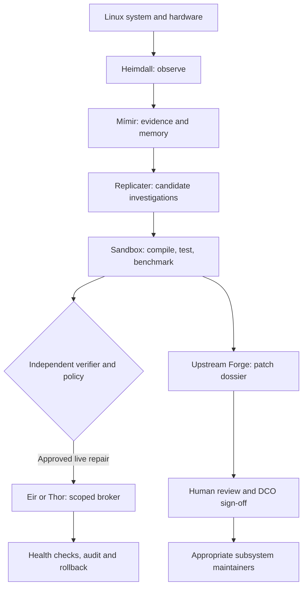

# ᛚᛁᚠᚦᚱᚨᛊᛁᚱ Project Lífþrasir
### The Self-Evolving Linux System

> **Linux that heals, learns, evolves, and gives back.**

**[Explore the complete 40-document research library](research/README.md)** · [Master research atlas](research/00-RESEARCH-ATLAS.md) · [Roadmap](research/27-ROADMAP-AND-MILESTONES.md) · [Research references](research/31-RESEARCH-BIBLIOGRAPHY.md)

## The vision

Lífþrasir is a **Mythic Engineering / RuneForgeAI research project** exploring Linux that can diagnose failures, safely repair eligible problems, independently test improvements and prepare evidence-backed patches for the wider Linux community. It envisions an **opt-in distributed engineering network** where participating systems contribute reusable technical knowledge without surrendering user control or private data.

**Current status:** research documents, GPLv2 license, project art and initial project organization. The planned autonomous Linux features are **not yet implemented**; proposals are labeled accordingly. Production kernel edits, boot changes and destructive system actions are outside the initial scope.

## The engineering pantheon

| Role | Technical purpose |
|---|---|
| **Heimdall** | Observe system services, logs, kernel and device health |
| **Mímir** | Local technical memory, research and evidence-grounded hypotheses |
| **Replicater** | Bounded multi-agent investigation and independent testing |
| **Eir** | Human-authorized reversible repair and rollback |
| **Thor** | Defensive threat hunting and reversible containment |
| **Upstream Forge** | Human-reviewed, reproducible patch dossiers for kernel maintainers |

## Proposed architecture

**Security boundary:** An LLM never holds unrestricted root privileges. All host changes use a deterministic policy engine and a narrow privileged broker. Experimental fixes are tested in disposable VMs; live modifications require explicit permission and a proven recovery plan.

## Research highlights

- **Architecture:** [reference design](research/02-REFERENCE-ARCHITECTURE.md), [threat model](research/03-THREAT-MODEL-AND-TRUST.md), [safe rollback](research/04-SAFE-REPAIR-AND-ROLLBACK.md).
- **Agent systems:** [Replicater](research/05-REPLICATER-ORCHESTRATION.md), [Eir](research/07-EIR-HEALING-ENGINE.md), [Thor](research/08-THOR-DEFENSE.md), [Mímir](research/09-MIMIR-KNOWLEDGE-AND-RAG.md).
- **Linux internals:** [kernel and drivers](research/12-KERNEL-DRIVER-RESEARCH.md), [fuzzing](research/15-FUZZING-AND-FAULT-INJECTION.md), [resource management](research/17-RESOURCE-MANAGEMENT.md), [GPU and NPU](research/18-ACCELERATOR-SUPPORT.md).
- **Self-evolution:** [controlled patch lifecycle](research/32-AUTONOMOUS-PATCH-LIFECYCLE.md), [formal verification](research/33-FORMAL-POLICY-VERIFICATION.md), [distributed federation](research/20-DISTRIBUTED-FEDERATION.md).
- **Implementation:** [APIs](research/25-API-AND-EVENT-SCHEMAS.md), [test plans](research/28-PROTOTYPE-EXPERIMENTS.md), [development roadmap](research/27-ROADMAP-AND-MILESTONES.md).

## First practical milestone

In a **disposable Kubuntu VM**, detect a deliberately broken noncritical user service, explain its likely cause with evidence, propose an exact reversible fix, obtain consent, apply via the scoped policy broker, verify functionality and prove rollback. This must work **offline** and remain operable if the AI model stops running.

## Contributing Linux patches responsibly

Linux kernel patches normally go to the appropriate subsystem maintainers and mailing lists, not automatically to Linus Torvalds or GitHub pull requests. A **human** reviews AI-assisted work, accepts responsibility and supplies any legitimate Developer Certificate of Origin sign-off. AI agents must not invent Signed-off-by tags or flood maintainers with unreviewed patches.

[Linux kernel contribution guide](https://docs.kernel.org/process/submitting-patches.html) · [AI coding assistant guidance](https://www.kernel.org/dochtml/latest/process/coding-assistants.html) · [Project upstream research](research/21-UPSTREAM-CONTRIBUTIONS.md)

## License

This repository contains the GNU **GPL version 2** license text, with GPL-2.0-only intended for compatible project code. Dependencies, firmware, model weights and artwork require their own license checks; see [licensing research](research/30-LICENSING-AND-DEPENDENCIES.md).

---

*Observe before judging. Test before changing. Preserve before repairing. Verify before contributing.* ᛟ
